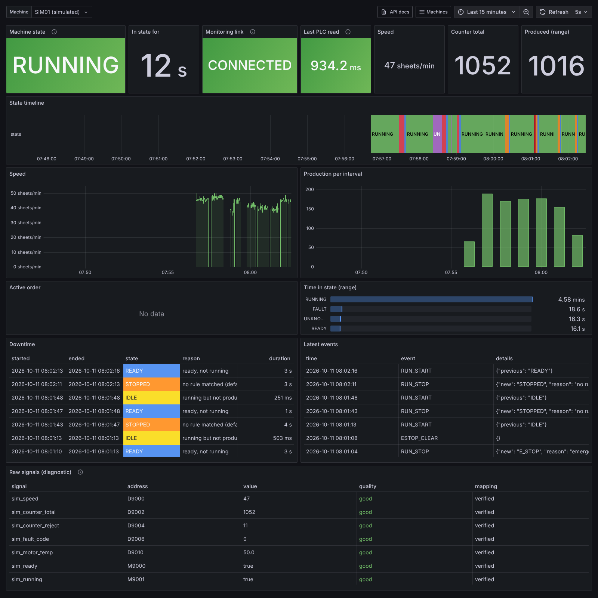

# Nueva Machine Monitoring Platform

On-premise platform that connects industrial machines to the factory
network, collects PLC/controller state, normalizes it, stores it as time
series and events, exposes it through a versioned API and shows it in
Grafana. Pilot machine: **JOBOTEHNIK RDC-53 / STACKER**.

> **Monitoring is read-only.** No PLC writes, no START/STOP, no forcing, no
> program changes. Losing the monitoring platform must never stop, control,
> or alter a production machine.

Status: **v0.1, first coding session.** The whole software path runs
end-to-end against a simulated machine. The RDC-53 is registered but
disabled until the read-only Mitsubishi driver (M4) and the on-site network
survey (Phase 0) are done.



## Quick start

### On a fresh Proxmox VE 8 host (one command)

```bash
git clone <repo> && cd <repo>/machine-monitoring
cp deploy/config.env.example deploy/config.env   # optional: VMID, storage, bridge, static IP...
sudo ./deploy/bootstrap.sh --check               # preflight only, changes nothing
sudo ./deploy/bootstrap.sh
```

This creates the `machine-monitoring-01` VM (Debian 13 cloud image, 4 vCPU, 8 GB RAM,
32 GB OS + 100 GB data disk). It installs Docker, generates secrets, starts the stack,
runs migrations, provisions Grafana, and checks the simulated machine end to end.
At the end it prints the Grafana URL, admin password and API URL. Re-running is safe.

To (re)provision an existing Debian VM without Proxmox:
`./deploy/bootstrap.sh --host <ip>` (needs `SSH_PUBLIC_KEY_FILE` in `deploy/config.env`).

### On any Docker host (development)

```bash
cd machine-monitoring
scripts/gen-env.sh                        # creates deploy/docker/.env with random secrets
cd deploy/docker && docker compose up -d --build
../../scripts/healthcheck.sh --wait 120
```

Then open `http://localhost/grafana/` (user `admin`, password from `GRAFANA_ADMIN_PASSWORD` in `.env`)
and `http://localhost/api/v1/docs`.

### Tests

```bash
pip install -r services/collector/requirements.txt -r services/simulator/requirements.txt pytest pytest-asyncio
python -m pytest            # unit + integration (collector against a live simulator); no PLC needed
```

## What runs

| Service | Role |
|---|---|
| `postgres` | PostgreSQL 16 + TimescaleDB: registry, raw/normalized samples, events, counters, downtime, orders |
| `migrate` | one-shot: applies `database/migrations/*.sql` once each, creates read-only `grafana_ro` role |
| `mosquitto` | internal MQTT bus `factory/{site}/{machine}/{state,signals,counter,event,health}` (password auth, not published) |
| `collector` | read-only drivers, poll groups, decoding, normalization, state machine, events; Prometheus metrics on :9108 |
| `simulator` | fake RDC-53-like stacker behind a PLC-like read API (profile `simulator`) |
| `api` | FastAPI REST `/api/v1/...`, OpenAPI at `/api/v1/docs` |
| `grafana` | provisioned datasource + "All machines" and "Machine detail" dashboards |
| `reverse-proxy` | Caddy: the only published port; `/api` and `/grafana` |
| `node-exporter`, `cadvisor` | host/container metrics for monitoring the monitor (Prometheus comes later) |

## Repository layout

```
machine-monitoring/
├── deploy/
│   ├── bootstrap.sh            # Proxmox: preflight -> VM -> provision -> verify
│   ├── config.env.example      # VM sizing / network / image (copy to config.env)
│   ├── vm/provision.sh         # runs on the VM: disk, SSH, Docker, .env, systemd, backup timer
│   └── docker/                 # docker-compose.yml, .env.example, mosquitto, caddy
├── services/
│   ├── collector/              # drivers/ (simulator, mitsubishi_slmp placeholder), model, events, storage
│   ├── api/
│   ├── simulator/
│   └── event-engine/           # v0.1 logic lives in collector/events.py (see README there)
├── machine-config/
│   ├── schema/machine.schema.json
│   ├── rdc53.yaml              # pilot machine - disabled, all addresses unverified
│   └── sim-rdc53.yaml          # simulated machine (also drives the simulator's memory map)
├── database/migrations/
├── grafana/{provisioning,dashboards}/
├── scripts/                    # gen-env, migrate, healthcheck, backup, restore-test
├── tests/{unit,integration,hardware}/
└── docs/                       # architecture, RDC-53 discovery, network survey template
```

## Key behaviours

* **UNKNOWN is a first-class state.** If any input needed to decide the state is stale
  or unreadable, the state is `UNKNOWN`, not `STOPPED`. If the collector stops reporting,
  the API and dashboards show `UNKNOWN` / "COLLECTOR DOWN". A monitoring failure is never
  shown as a machine stop.
* **Unverified addresses are never silent.** Every signal is `verified` or `unverified`.
  Anything derived from an unverified signal is published with quality `uncertain`.
* **No write path.** The driver base class refuses any method named `write*`, `force*`,
  `set_*`, etc. at class-definition time. The schema and database both require
  `read_only = true`.
* **Adding a machine means adding configuration.** You add a YAML file (and a driver if
  the protocol is new). The core, database, API and dashboards stay the same.

## Configuration

* `deploy/config.env`: Proxmox/VM settings (git-ignored).
* `deploy/docker/.env`: secrets and runtime settings, generated by `scripts/gen-env.sh`
  (git-ignored, mode 600). Existing values are never overwritten.
* `machine-config/*.yaml`: one file per machine, validated against
  `machine-config/schema/machine.schema.json` at collector start.

## Next milestones

See `docs/architecture.md` § Roadmap. In order: Mitsubishi read-only SLMP driver (M4),
then the RDC-53 network survey and device discovery (M5), then the ERP bridge (M6),
then OT VLAN/firewall, off-host backups and alerting (M7).
